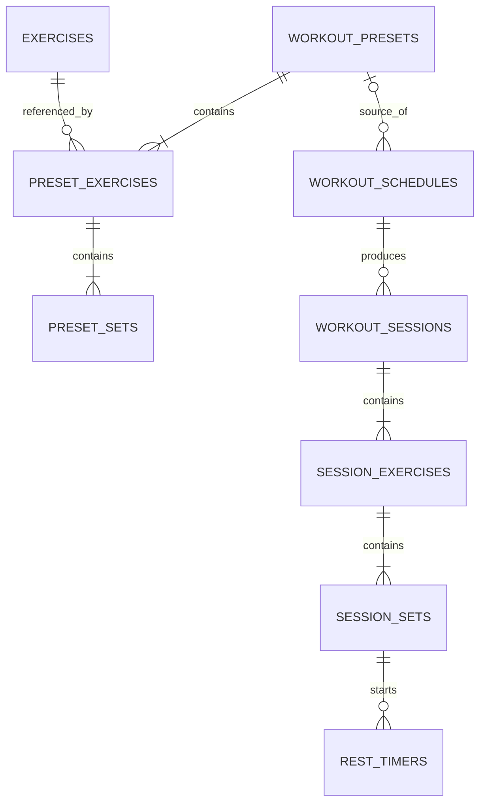

# FLEX — ข้อเสนอโครงสร้างข้อมูล

วันที่: 2026-10-14 · สถานะ: แบบจำลองสำหรับเริ่มพัฒนา ยังไม่ได้สร้างฐานข้อมูลจริง

## 1. แนวทาง

ใช้ฐานข้อมูลในเครื่อง เช่น SQLite และแยกส่วนจัดเก็บข้อมูลออกจาก UI ผ่าน Repository ข้อมูลมี 4 ชั้น: **คลังท่า → Preset → Snapshot ในตาราง → ผลการฝึกจริง**

- Preset เป็นแม่แบบที่แก้ไขได้
- ตารางเก็บสำเนา Preset ณ ตอนนำไปใช้
- Session เก็บสำเนาเป้าหมายของตัวเองและผลจริงแยกกัน
- ประวัติคือ Session ที่จบแล้ว ไม่จำเป็นต้องมีตาราง History ซ้ำอีกชุด

## 2. ข้อตกลงร่วม

| รายการ | ข้อเสนอ |
|---|---|
| ID | ข้อความ UUID ที่สร้างในเครื่อง; แต่ละเซตมี ID คงที่แยกจากลำดับที่แสดง |
| ลำดับท่า/เซต | `position` เป็นจำนวนเต็ม เริ่ม 1; จัดลำดับใหม่เมื่อเพิ่ม/ลบโดยไม่เปลี่ยน ID |
| น้ำหนัก | เก็บเป็นจำนวนเต็มหน่วยกรัม เช่น 42.5 กก. = 42500 กรัม; แสดง UI เป็นกิโลกรัม |
| น้ำหนักตัว | ใช้ `null` ในช่องน้ำหนักที่ไม่มีความหมาย ไม่ใช้ 0 แทนน้ำหนักตัว |
| จำนวนครั้ง | จำนวนเต็มมากกว่า 0 |
| เวลาพัก | จำนวนเต็มหน่วยวินาที ตั้ง 0 เพื่อไม่จับเวลา |
| Timestamp | เก็บเวลาเหตุการณ์เป็น UTC พร้อมเขตเวลาของรายการในตาราง |
| วันและเวลาฝึก | เก็บวันที่/เวลาท้องถิ่นที่ผู้ใช้เลือก และ IANA timezone เช่น `Asia/Bangkok` |
| Snapshot | JSON ที่มี `schema_version` เพื่อรองรับการเปลี่ยนรูปแบบข้อมูลภายหลัง |
| ค่ารวม | จำนวนท่า จำนวนเซต และจำนวนเซตสำเร็จคำนวณจากรายการลูก |

การเก็บน้ำหนักเป็นกรัมเป็นรายละเอียดฐานข้อมูล ไม่ต้องแสดงหน่วยนี้ในหน้าจอ ค่าน้ำหนัก 0 ยังใช้ได้กับท่าประเภทใช้น้ำหนัก หากเป็นผลที่ผู้ใช้ตั้งใจบันทึก

## 3. Enum หลัก

| Enum | ค่าและความหมาย |
|---|---|
| `LoadMode` | `external_load`: น้ำหนักอุปกรณ์; `bodyweight`: น้ำหนักตัว; `bodyweight_plus_load`: น้ำหนักที่ถ่วงเพิ่ม |
| `ScheduleStatus` | `planned`, `in_progress`, `completed`, `skipped`, `cancelled` |
| `SessionStatus` | `in_progress`, `paused`, `finished`, `abandoned` |
| `SetStatus` | `pending`, `completed` |
| `RestTimerStatus` | `running`, `completed`, `skipped`, `cancelled` |

สถานะฝึกครบ/บางส่วนคำนวณจากเซตใน Session เมื่อจบ ไม่ใช้แทน `SessionStatus` เพราะทั้งสองกรณีเป็นการจบ Session ได้

## 4. ความสัมพันธ์



ความสัมพันธ์ในภาพหมายถึงข้อมูลที่บันทึกสำเร็จแล้ว ระหว่างสร้าง Preset ที่ยังไม่บันทึก สามารถยังไม่มีท่าหรือเซตได้

## 5. ตารางข้อมูลที่เสนอ

### 5.1 `exercises` — คลังท่า

| ฟิลด์ | ชนิดเชิงตรรกะ | ความหมาย |
|---|---|---|
| `id` | UUID, PK | ID ของท่า |
| `name` | text | ชื่อ เช่น Bench Press, Push-up |
| `muscle_group` | text | กลุ่มกล้ามเนื้อสำหรับแสดงผล |
| `allowed_load_modes_json` | JSON array | รูปแบบน้ำหนักที่ท่านี้รองรับ |
| `default_load_mode` | LoadMode | ค่าเริ่มต้น ต้องอยู่ในรายการที่รองรับ |
| `is_active` | boolean | ใช้แสดง/ซ่อนจากคลังโดยไม่ทำให้ประวัติขาดข้อมูล |
| `created_at`, `updated_at` | UTC timestamp | เวลาสร้างและแก้ไข |

ตัวอย่าง: Bench Press รองรับ `external_load`; Push-up รองรับ `bodyweight` และ `bodyweight_plus_load` การเลือกท่าไม่ควรอนุมานรูปแบบจากน้ำหนักว่าเป็น 0 หรือไม่

### 5.2 `workout_presets` — หัวโปรแกรมต้นแบบ

`id` (PK), `name`, `created_at`, `updated_at`

ชื่อโปรแกรมต้องไม่ว่าง จำนวนท่าและจำนวนเซตรวมอ่านจากตารางลูก ไม่เก็บซ้ำในหัวโปรแกรม

### 5.3 `preset_exercises` — ท่าใน Preset

| ฟิลด์ | ชนิดเชิงตรรกะ | ความหมาย |
|---|---|---|
| `id` | UUID, PK | ID ของท่าในโปรแกรม |
| `preset_id` | FK → workout_presets | โปรแกรมเจ้าของ |
| `exercise_id` | FK → exercises | ท่าที่เลือกจากคลัง |
| `position` | integer | ลำดับท่า |
| `load_mode` | LoadMode | รูปแบบที่ใช้กับท่านี้ใน Preset นี้ |
| `rest_seconds` | integer ≥ 0 | เวลาพักเดียวกันระหว่างเซตของท่านี้ |

ไม่เก็บจำนวนครั้งหรือน้ำหนักรวมในแถวนี้ เพราะต้องกำหนดได้แยกทุกเซต

### 5.4 `preset_sets` — เป้าหมายแต่ละเซต

| ฟิลด์ | ชนิดเชิงตรรกะ | ความหมาย |
|---|---|---|
| `id` | UUID, PK | ID เซตเป้าหมาย |
| `preset_exercise_id` | FK → preset_exercises | ท่าเจ้าของ |
| `position` | integer | ลำดับเซต |
| `target_reps` | integer > 0 | จำนวนครั้งเป้าหมาย |
| `target_load_grams` | nullable integer ≥ 0 | น้ำหนักอุปกรณ์หรือน้ำหนักเพิ่ม; `null` สำหรับน้ำหนักตัว |

ตัวอย่าง Bench Press เก็บเป็น 3 แถว: `(40000, 12)`, `(45000, 10)`, `(50000, 8)` ส่วน Push-up น้ำหนักตัวเป็น `(null, 15)`, `(null, 12)`

### 5.5 `workout_schedules` — รายการที่ลงตาราง

| ฟิลด์ | ชนิดเชิงตรรกะ | ความหมาย |
|---|---|---|
| `id` | UUID, PK | ID รายการในตาราง |
| `source_preset_id` | nullable FK → workout_presets | อ้างอิงต้นทางเพื่อดูที่มา ไม่ใช้โหลดค่าปัจจุบันทับ Snapshot |
| `local_date` | date | วันที่ที่ผู้ใช้เลือก |
| `local_time` | time | เวลาที่ผู้ใช้เลือก |
| `timezone_id` | text | เขตเวลาของรายการ |
| `planned_start_at` | UTC timestamp | เวลาที่แปลงแล้วสำหรับจัดลำดับ/นัดหมาย |
| `status` | ScheduleStatus | สถานะรายการ |
| `program_snapshot_json` | versioned JSON | สำเนาโปรแกรม ท่า รูปแบบน้ำหนัก เป้าหมายทุกเซต และเวลาพัก |
| `created_at`, `updated_at` | UTC timestamp | เวลาสร้างและแก้ไข |

ไม่กำหนด `local_date` เป็น unique เพื่อรองรับหลายรายการต่อวัน เมื่อแก้เฉพาะวันเวลา ให้รักษา Snapshot เดิมไว้ การเลือก Preset ใหม่จึงค่อยสร้าง Snapshot ใหม่

### 5.6 `workout_sessions` — การฝึกแต่ละครั้ง

| ฟิลด์ | ชนิดเชิงตรรกะ | ความหมาย |
|---|---|---|
| `id` | UUID, PK | ID Session; ใช้ซ้ำเมื่อฝึกต่อหรือกดบันทึกซ้ำ |
| `schedule_id` | FK → workout_schedules | รายการในตารางที่เริ่มฝึก |
| `program_name_snapshot` | text | ชื่อโปรแกรม ณ ตอนเริ่มฝึก |
| `status` | SessionStatus | กำลังฝึก พักไว้ จบ หรือยุติโดยไม่บันทึกเป็นการฝึกสำเร็จ |
| `started_at` | UTC timestamp | เวลาเริ่ม |
| `finished_at` | nullable UTC timestamp | เวลาจบ |
| `updated_at` | UTC timestamp | เวลาที่บันทึกการเปลี่ยนแปลงล่าสุด |

หนึ่งรายการในตารางอาจมีหลาย Session เมื่อผู้ใช้เริ่มการฝึกใหม่อย่างชัดเจน แต่การกลับมาฝึกต่อหรือกดปุ่มซ้ำต้องไม่สร้าง Session ใหม่ ข้อเสนอ MVP คืออนุญาตให้มี Session ที่กำลังฝึก/พักค้างเพียงหนึ่งรายการในเวลาเดียวกัน

### 5.7 `session_exercises` — ท่าที่ตรึงไว้ใน Session

`id` (PK), `session_id` (FK), `source_exercise_id` (nullable FK), `name_snapshot`, `muscle_group_snapshot`, `position`, `load_mode`, `rest_seconds`

สร้างจาก Snapshot ในตาราง ไม่อ่านชื่อ รูปแบบ หรือค่าจาก Preset ปัจจุบันมาแทน ระหว่าง Session การแก้เวลาพักมีผลกับการติ๊กครั้งถัดไป ไม่เปลี่ยนตัวจับเวลาที่เริ่มไปแล้ว

### 5.8 `session_sets` — เป้าหมายและผลจริงของแต่ละเซต

| ฟิลด์ | ชนิดเชิงตรรกะ | ความหมาย |
|---|---|---|
| `id` | UUID, PK | ID เซตจริง คงที่แม้ลำดับเปลี่ยน |
| `session_exercise_id` | FK → session_exercises | ท่าเจ้าของ |
| `position` | integer | ลำดับเซตใน Session |
| `is_extra` | boolean | เป็นเซตที่เพิ่มระหว่างฝึกหรือไม่ |
| `target_reps` | nullable integer > 0 | สำเนาเป้าหมาย; อาจว่างสำหรับเซตเพิ่ม |
| `target_load_grams` | nullable integer ≥ 0 | สำเนาน้ำหนักเป้าหมาย |
| `actual_reps` | nullable integer > 0 | ผลที่ผู้ใช้กรอก สามารถค้างไว้ก่อนติ๊กได้ |
| `actual_load_grams` | nullable integer ≥ 0 | น้ำหนักที่กรอกจริง; ว่างสำหรับท่าน้ำหนักตัว |
| `status` | SetStatus | รอยืนยันหรือสำเร็จแล้ว |
| `completed_at` | nullable UTC timestamp | เวลาที่ติ๊กสำเร็จ |
| `rest_seconds_at_completion` | nullable integer ≥ 0 | เวลาพักที่ใช้ ณ ตอนติ๊ก |

ค่าเริ่มต้นในช่องผลจริงอาจคัดลอกจากเป้าหมายได้ แต่ยังต้องเป็น `pending` จนผู้ใช้ยืนยัน ประวัติใช้เฉพาะแถว `completed` ไม่ตีความค่าที่เติมไว้ล่วงหน้าว่าทำสำเร็จแล้ว

เซตเพิ่มระหว่างฝึกอาจเติมช่องกรอกจากเซตก่อนหน้าเพื่อความสะดวก แต่ไม่เขียนกลับไปยัง Preset และต้องระบุ `is_extra` ไว้

### 5.9 `rest_timers` — สถานะเวลาพัก

`id` (PK), `session_id` (FK), `session_set_id` (FK), `duration_seconds`, `started_at`, `ends_at`, `status`, `notified_at` (nullable), `os_notification_id` (nullable)

- คำนวณเวลาที่เหลือจาก `ends_at - เวลาปัจจุบัน` ไม่เก็บตัวนับที่ต้องลดทีละวินาทีเป็นแหล่งข้อมูลหลัก
- มีตัวจับเวลาที่ `running` ได้เพียงหนึ่งรายการสำหรับ Session ที่ใช้งาน
- ติ๊กเซตใหม่ให้ยกเลิกตัวเดิม ก่อนสร้างตัวใหม่
- `notified_at` ใช้ป้องกันการแจ้งเตือนซ้ำ
- เมื่อเปิดแอปใหม่และพบเวลาหมดไปแล้ว ให้แสดงพักครบ ไม่เล่นเสียงซ้ำอย่างต่อเนื่อง
- การข้ามพัก ยกเลิกเซตต้นทาง หรือจบ Session ต้องยกเลิกการแจ้งเตือนที่เกี่ยวข้องด้วย

## 6. ตัวอย่าง Snapshot ของรายการในตาราง

ตัวอย่างนี้ใช้หน่วยกรัมตามฐานข้อมูล และย่อรายการท่าให้สั้นเพื่ออ่านง่าย:

```json
{
  "schema_version": 1,
  "source_preset_id": "preset-uuid",
  "program_name": "วันอก",
  "exercises": [
    {
      "source_exercise_id": "bench-press-uuid",
      "name": "Bench Press",
      "muscle_group": "อก",
      "position": 1,
      "load_mode": "external_load",
      "rest_seconds": 90,
      "sets": [
        { "position": 1, "target_load_grams": 40000, "target_reps": 12 },
        { "position": 2, "target_load_grams": 45000, "target_reps": 10 },
        { "position": 3, "target_load_grams": 50000, "target_reps": 8 }
      ]
    },
    {
      "source_exercise_id": "push-up-uuid",
      "name": "Push-up",
      "muscle_group": "อก",
      "position": 2,
      "load_mode": "bodyweight",
      "rest_seconds": 60,
      "sets": [
        { "position": 1, "target_load_grams": null, "target_reps": 15 },
        { "position": 2, "target_load_grams": null, "target_reps": 12 }
      ]
    }
  ]
}
```

## 7. กฎความถูกต้องและการบันทึก

1. ลำดับต้องไม่ซ้ำภายในเจ้าของเดียวกัน เช่น `(preset_exercise_id, position)`
2. รูปแบบน้ำหนักที่เลือกต้องอยู่ในรายการที่ท่ารองรับ
3. `bodyweight` ต้องไม่มีน้ำหนักเป้าหมายหรือผลจริง; อีกสองรูปแบบต้องมีน้ำหนักเมื่อยืนยันเซต
4. `completed` ต้องมีจำนวนครั้งจริงที่ถูกต้องและ `completed_at`
5. เซตที่ยัง `pending` อาจมีข้อมูลกรอกค้างไว้ แต่ไม่นับในประวัติที่สำเร็จ
6. บันทึกหัวโปรแกรม ท่า และเซตใน Transaction เดียว ป้องกัน Preset ไม่ครบชุด
7. การติ๊กเซตและสร้าง/แทนที่เวลาพักต้องประสานการบันทึกให้สอดคล้องกัน หากนัดแจ้งเตือนระบบไม่สำเร็จ ข้อมูลเซตยังต้องไม่สูญหาย
8. การกดจบ Session ซ้ำอ้างอิง ID เดิมและไม่สร้างประวัติซ้ำ
9. ป้องกันการลบหรือแก้ต้นทางแล้วลบประวัติแบบ Cascade; ใช้ Snapshot และอ้างอิงต้นทางแบบว่างได้ตามความเหมาะสม
10. การลบเซตล่าสุดต้องเก็บค่าพร้อมตำแหน่งไว้สำหรับ Undo; ไม่ให้เหลือศูนย์เซตในท่าที่ยังอยู่
11. ดัชนีที่ควรมี: วัน/สถานะของตาราง, `schedule_id` ของ Session, เวลาเริ่ม Session, FK และลำดับของท่า/เซต

ข้อกำหนดที่ตรวจได้ในแถวเดียวควรใช้ข้อจำกัดฐานข้อมูล ส่วนเงื่อนไขข้ามตาราง เช่น รูปแบบน้ำหนักกับผลเซต ให้ตรวจในชั้นข้อมูลภายใน Transaction ด้วย

## 8. โมเดลและความรับผิดชอบใน Flutter

โมเดลหลักที่เสนอ: `Exercise`, `WorkoutPreset`, `PresetExercise`, `PlannedSet`, `WorkoutSchedule`, `ProgramSnapshot`, `WorkoutSession`, `SessionExercise`, `SessionSet`, `RestTimer`

โครงสร้างโค้ดเริ่มต้น:

```text
lib/
  app/                     # ธีม การนำทาง การประกอบ dependency
  core/                    # เวลา เขตเวลา รูปแบบหน่วย และ ID
  features/
    exercises/             # คลังท่าและรูปแบบน้ำหนัก
    programs/              # สร้างและแก้ Preset รายเซต
    schedule/              # เลือกวันเวลาและจัดการ Snapshot
    workout/               # Session ผลจริง และเวลาพัก
    history/               # อ่าน Session ที่จบแล้ว
  data/
    local/                 # ฐานข้อมูลและ migration
    repositories/          # อ่าน/เขียนข้อมูลและ Transaction
  shared/
    widgets/               # แถวเซต การปัดลบ ช่องกรอก และปุ่มร่วม
```

- UI/ViewModel จัดการสถานะหน้าจอและเรียกใช้งาน Repository
- Repository ดูแลกฎข้อมูล Snapshot และการบันทึก
- ตัวจับเวลาใช้บริการเวลาและบริการแจ้งเตือน โดย UI แสดงเวลาจากวันเวลาสิ้นสุด
- หน้าจัดโปรแกรมกับหน้าฝึกใช้ส่วนแถวเซตร่วมกัน โดยมีโหมด `planning`/`logging` และแสดงคอลัมน์ตาม `LoadMode`

รายละเอียดการเลือกแพ็กเกจ การจัดการ State และ API แจ้งเตือนของแต่ละระบบ ค่อยตรวจเอกสารปัจจุบันตอนเริ่มเขียนโค้ด ไม่ตรึงเวอร์ชันไว้ในสเปกนี้
